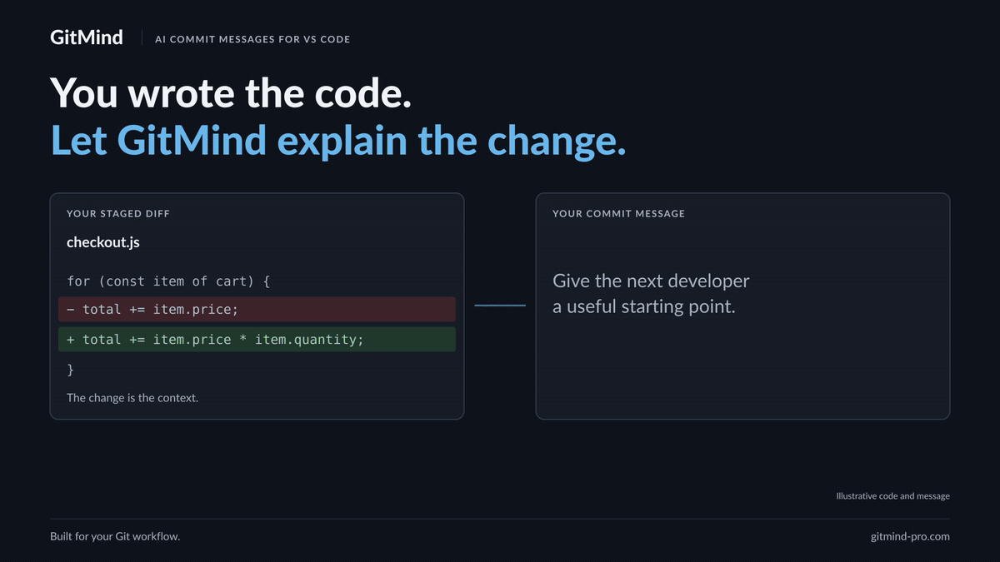
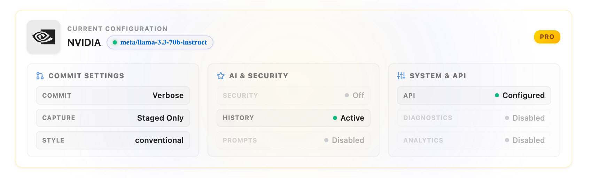
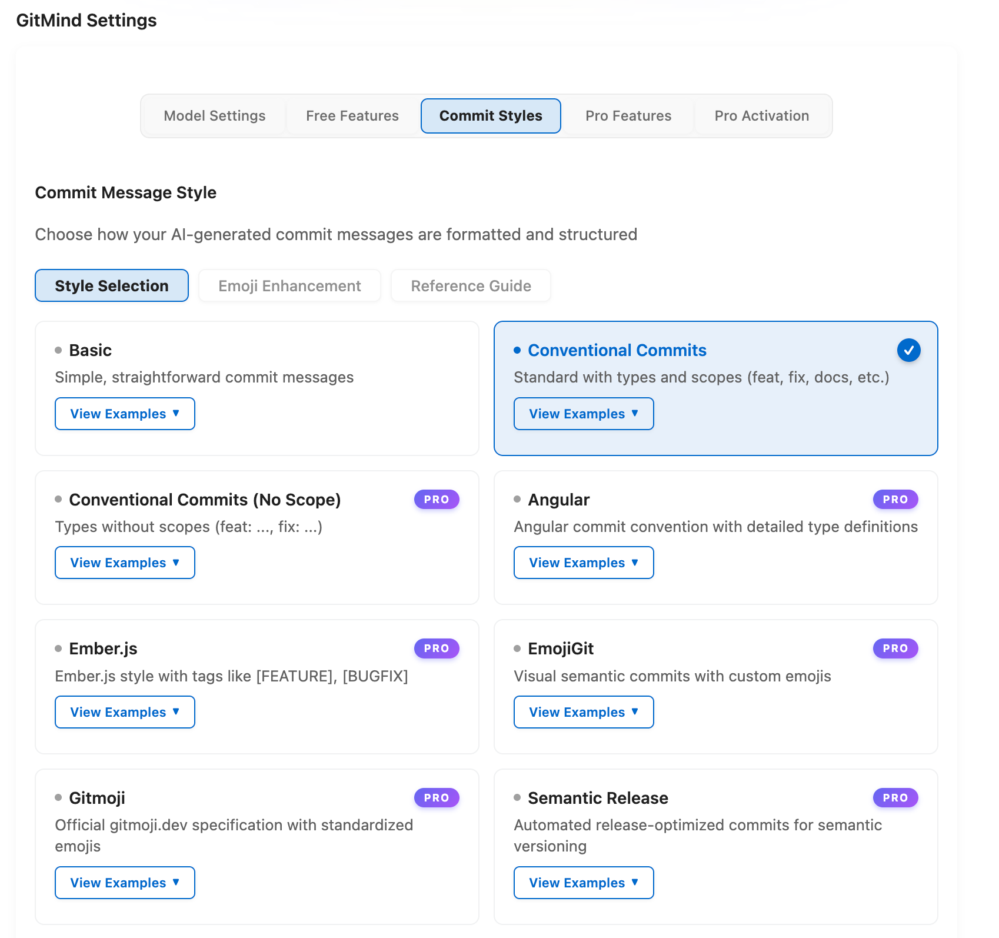
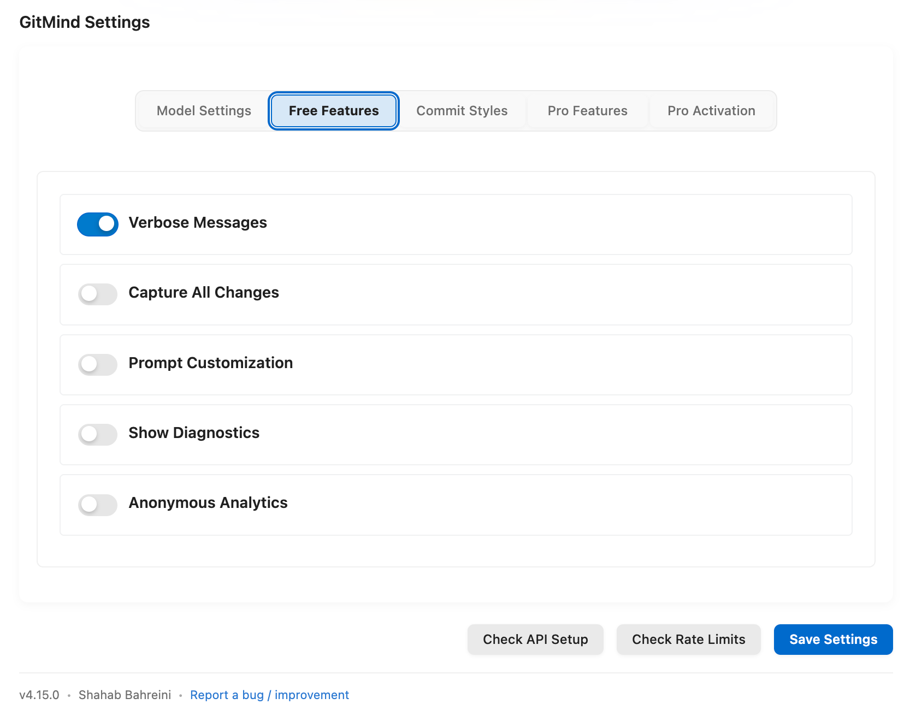
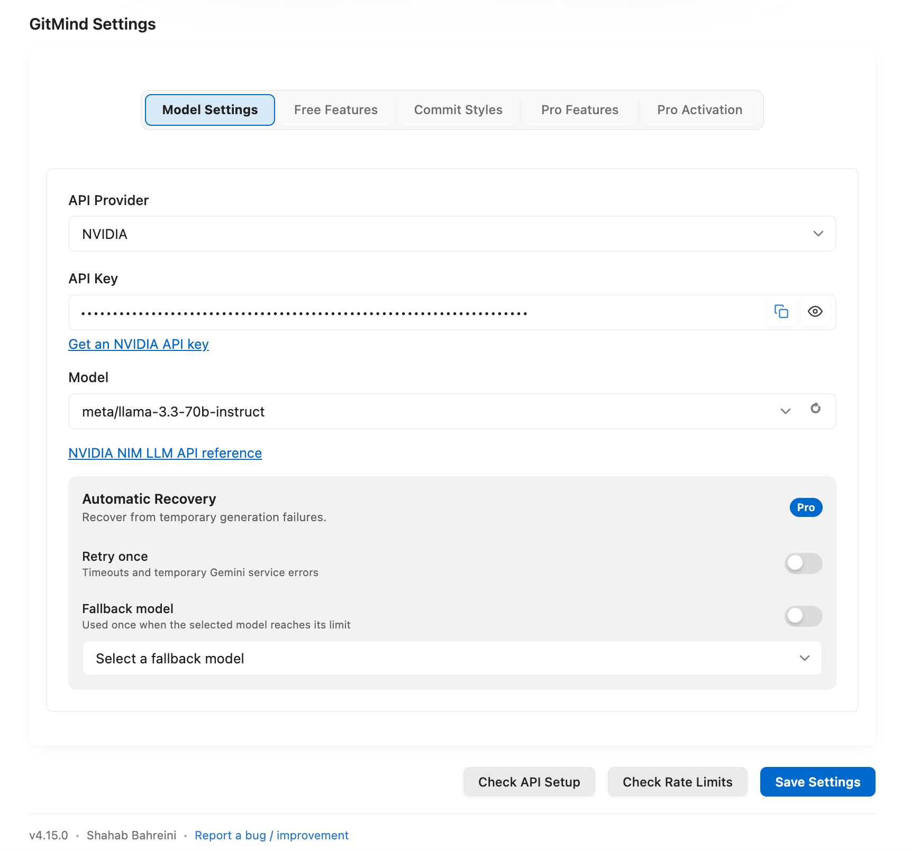
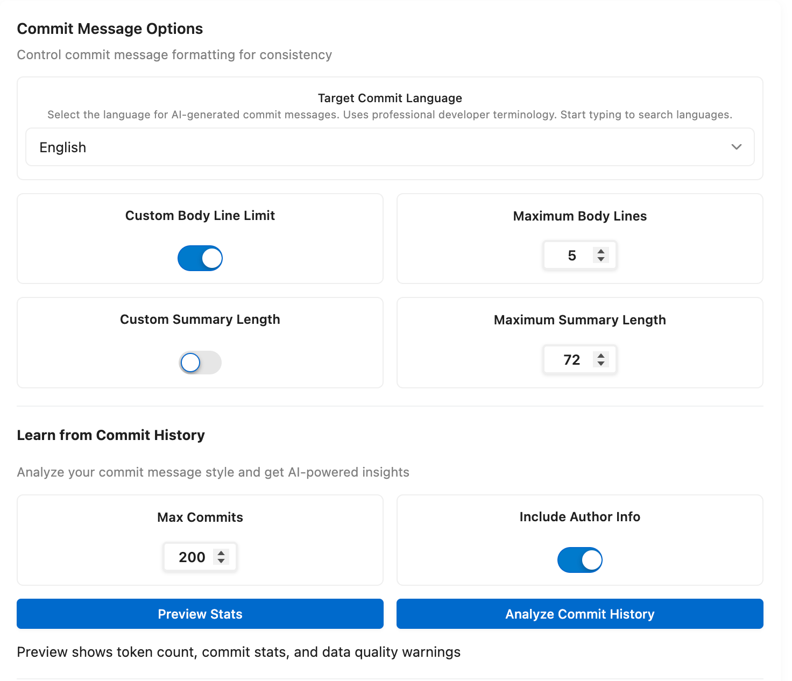
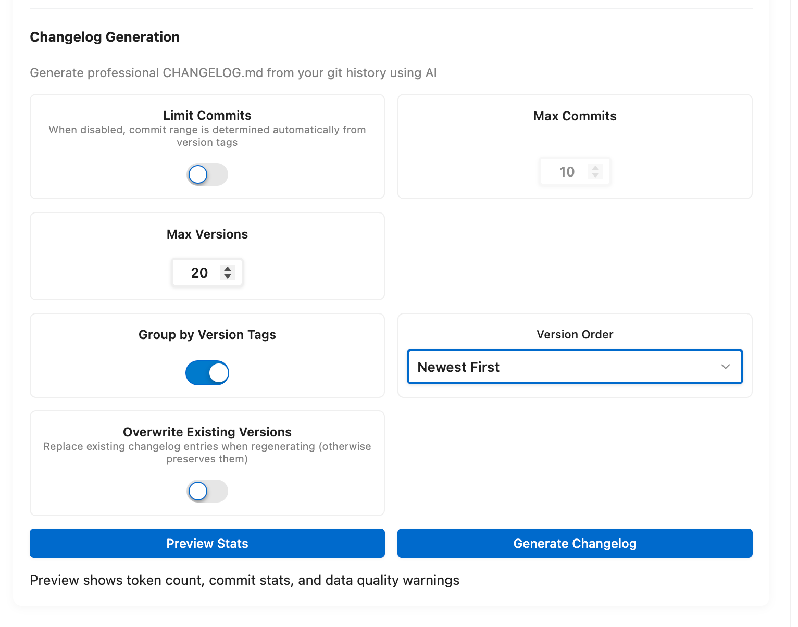

# GitMind — AI Commit Message Generator for VS Code

GitMind reads your Git diff and writes a clear, well-formatted commit message for you. Use GitHub Copilot, a local model in Ollama or LM Studio, or any of 22 built-in AI providers, and get Conventional Commits, Gitmoji, or your team's style in one click.

  
   
  <strong>Stage your changes, click GitMind in Source Control, and review the generated commit message.</strong>

## Install

- **VS Code:** [Install from the Visual Studio Marketplace](https://marketplace.visualstudio.com/items?itemName=ShahabBahreiniJangjoo.ai-commit-assistant)
- **VSCodium and other editors that use Open VSX:** [Install from Open VSX](https://open-vsx.org/extension/ShahabBahreiniJangjoo/ai-commit-assistant), or search for **GitMind** in the Extensions view
- **Manual:** Download the `.vsix` from [GitHub Releases](https://github.com/shahabahreini/GitMind-Community/releases) and run **Extensions: Install from VSIX…**

## Quick Start

1. Open **GitMind Settings** and choose a provider. GitHub Copilot, Ollama, and LM Studio need no API key.
2. Add an API key if your provider needs one, then pick a model from the searchable list.
3. Stage your changes and click the GitMind icon in Source Control, or run **Generate GitMind Commit Message**.

## Why GitMind

- **Works with the AI you already have:** GitHub Copilot, local Ollama or LM Studio, OpenAI, Anthropic Claude, Gemini, DeepSeek, OpenRouter, Azure OpenAI, Amazon Bedrock, Vertex AI, and more.
- **Keeps code on your machine when you want it:** Local models generate commit messages without sending your diff anywhere.
- **Follows your commit convention:** Conventional Commits and Basic are free. Angular, Semantic Release, Gitmoji, Linux Kernel, and other styles come with Pro.
- **Handles real-world diffs:** Token-aware processing keeps large changes useful, and **Capture All Changes** includes unstaged and untracked files.
- **Always shows the current models:** GitMind loads live model lists from providers that support discovery, and the pickers are searchable.
- **Grows with your workflow (Pro):** Compare three draft messages, check Commit Health, run a pre-commit AI review, plan atomic commits, and generate changelogs.

## Explore GitMind

<table>
  <tr>
    <td width="50%" valign="top">
      
      <h3 align="center">Everything At A Glance</h3>
      
See your provider, model, commit preferences, security, and API status in one place.

    </td>
    <td width="50%" valign="top">
      
      <h3 align="center">Professional Commit Styles</h3>
      
Choose Conventional Commits, Angular, Gitmoji, Semantic Release, and other structured formats.

    </td>
  </tr>
  <tr>
    <td width="50%" valign="top">
      
      <h3 align="center">Useful Free Features</h3>
      
Control message detail, capture all changes, add custom context, and see generation diagnostics.

    </td>
    <td width="50%" valign="top">
      
      <h3 align="center">Models And Automatic Recovery</h3>
      
Load and search provider models. Pro retries temporary failures and can switch to a fallback model.

    </td>
  </tr>
  <tr>
    <td width="50%" valign="top">
      
      <h3 align="center">Match Your Team (Pro)</h3>
      
Write commit messages in your team's language and learn from your existing commit history.

    </td>
    <td width="50%" valign="top">
      
      <h3 align="center">AI Changelog Generation (Pro)</h3>
      
Generate changelogs from Git history with version grouping and configurable commit ranges.

    </td>
  </tr>
</table>

## Supported Providers

| Provider              | Setup                                  | Model selection                          |
| --------------------- | -------------------------------------- | ---------------------------------------- |
| GitHub Copilot        | Active Copilot subscription            | Available Copilot models                 |
| Ollama                | Local server, no API key               | Local model discovery                    |
| LM Studio             | Local loopback server, no API key      | Local OpenAI-compatible model discovery  |
| OpenAI                | API key                                | Dynamic model discovery                  |
| Anthropic Claude      | API key                                | Dynamic model discovery                  |
| Google Gemini         | API key                                | Searchable Gemini models                 |
| DeepSeek              | API key                                | Chat and reasoning models                |
| OpenRouter            | API key                                | Dynamic multi-provider catalog           |
| Mistral AI            | API key                                | Dynamic model discovery                  |
| xAI Grok              | API key                                | Dynamic model discovery                  |
| Groq                  | API key                                | Dynamic model discovery                  |
| Cohere                | API key                                | Dynamic model discovery                  |
| Together AI           | API key                                | Dynamic model discovery                  |
| Perplexity            | API key                                | Curated Sonar models                     |
| Hugging Face          | Access token                           | Hosted model ID                          |
| MiniMax               | API key                                | Dynamic model discovery                  |
| Z.ai                  | API key                                | GLM model selection                      |
| NVIDIA hosted NIM     | API key from NVIDIA Build              | Dynamic NIM model discovery              |
| Azure OpenAI          | API key or Microsoft Entra token       | Deployment name (account-specific)       |
| Amazon Bedrock        | AWS credential chain or named profile  | Model ID available in selected region    |
| Vertex AI             | Google Application Default Credentials | Model ID available to project/location   |
| Cloudflare Workers AI | API token and account ID               | Workers AI or AI Gateway model ID        |
| Custom API (Pro)      | Any OpenAI-compatible endpoint         | Your endpoint and model                  |

Provider catalogs change often. GitMind loads current model lists where the provider supports discovery and falls back to known compatible models when it can't. Setup guides for each provider are in [Providers and Models](https://github.com/shahabahreini/GitMind-Community/wiki/Providers-And-Models).

## Free And Pro

| Feature                                  | Free             | Pro                                                |
| ---------------------------------------- | ---------------- | -------------------------------------------------- |
| Built-in AI providers                    | 22               | 22                                                 |
| Custom API provider                      | Locked           | Included                                           |
| Searchable provider and model pickers    | Included         | Included                                           |
| Basic and Conventional commit styles     | Included         | Included                                           |
| Professional commit styles               | Limited          | Included                                           |
| Emoji Enhancement                        | Visible, locked  | Included                                           |
| Draft choices, Commit Health, pre-commit review, commit composer | Locked | Included                            |
| Automatic Recovery                       | Locked           | Retry once and optionally switch models once       |
| API key storage                          | VS Code settings | Encrypted SecretStorage                            |
| Target commit language                   | Default          | Searchable language selection                      |
| Advanced model parameters                | Automatic        | Custom temperature, top-p, top-k, and token limits |
| Commit history learning                  | Locked           | Included                                           |
| Changelog generation                     | Locked           | Included                                           |
| Sanitized support report                 | Locked           | Local, review-before-share JSON report             |

GitMind Pro is a **one-time lifetime purchase**, with no subscription. [See Pro pricing](https://gitmind-pro.com/pricing?utm_source=extension-listing&utm_medium=readme&utm_campaign=free-vs-pro). To activate, open **GitMind Settings > Pro** and paste the license key from your purchase email. Manage licenses and devices in the [account portal](https://gitmind-pro.com/portal?utm_source=extension-listing&utm_medium=readme&utm_campaign=activation). Details on Automatic Recovery and the other Pro features are in the [GitMind Pro guide](https://github.com/shahabahreini/GitMind-Community/wiki/GitMind-Pro).

If your key does not work, or you cannot find it, open an issue at [GitMind-Community Issues](https://github.com/shahabahreini/GitMind-Community/issues) and we will sort it out. You will not lose access while we do.

## Privacy And Security

- GitMind sends the selected Git diff and prompt only to the provider you configure.
- Ollama and LM Studio keep generation on your machine.
- GitMind Pro can store provider keys in VS Code SecretStorage.
- GitMind does not collect or transmit product telemetry.
- Pro users can capture a bounded, local support report containing only allowlisted operational metadata. It excludes source, diffs, prompts, paths, URLs, credentials, request/response bodies, raw errors, email, and license/customer data.

More in [Security and Privacy](https://github.com/shahabahreini/GitMind-Community/wiki/Security-And-Privacy).

## Requirements

- VS Code 1.101.0 or newer, or a compatible editor
- A Git repository
- An API key for your cloud provider, unless you use GitHub Copilot (editor sign-in), Ollama or LM Studio (local), or Amazon Bedrock or Vertex AI (cloud credentials)

## Support

- [Official website](https://gitmind-pro.com?utm_source=extension-listing&utm_medium=readme&utm_campaign=support)
- [GitMind documentation (wiki)](https://github.com/shahabahreini/GitMind-Community/wiki)
- [Report an issue](https://github.com/shahabahreini/GitMind-Community/issues)
- For hard-to-reproduce problems, Pro users can open **GitMind Settings > Pro > Support Report**, start a session, reproduce the issue, stop and review it, then save and attach the JSON report.

If GitMind saves you time, a rating helps other developers find it: [rate on the VS Code Marketplace](https://marketplace.visualstudio.com/items?itemName=ShahabBahreiniJangjoo.ai-commit-assistant&ssr=false#review-details) or [on Open VSX](https://open-vsx.org/extension/ShahabBahreiniJangjoo/ai-commit-assistant/reviews).
