# Implementation Plan: Custom API Form, Pro Upgrade Screen, Encryption Report & Inception Model Loading

## Executive Summary
This implementation plan addresses four interconnected user requirements across GitMind Pro's settings and API management experiences:
1. **Custom API Form & Connection Diagnostics**: Modernize the form layout with 3 semantic sections, one-click quick presets, real-time target URL resolution, inline connection testing, and a rich diagnostics panel (latency, HTTP status badges, format chips, and troubleshooting advice).
2. **"Upgrade to GitMind Pro" Screen Audit & Redesign**: Eliminate the unreadable low-contrast "Already Purchased" disabled button (contrast ~1.4:1), replace it with a high-contrast active badge pill, eliminate duplicate bullet points (`• ✓`), and improve spacing and typography.
3. **Encryption Status Report Overhaul**: Redesign the modal report from a nested double-bordered box into a modern security dashboard featuring a hero status shield, 4-metric KPI tiles, refined provider tags, and OS keychain assurance notes.
4. **Fix Inception "Load Available Models"**: Wire `inception` into `ScriptManager.ts`'s `modelConfigs` array and `modelHandlers.ts` so the button listener is properly attached and model discovery functions seamlessly.

---

## Architecture & Visual Hierarchy

```mermaid
flowchart TD
    subgraph CustomAPI["1. Custom API Integration"]
        Presets["Quick Presets Toolbar\n(OpenAI / vLLM / LM Studio / Claude)"]
        Sections["Semantic Sections\n1. Endpoint & Server\n2. Authentication & Security\n3. Model & Payload Format"]
        InlineTest["Inline Test Connection Button\n(In-flight loading state)"]
        Diagnostics["Rich Diagnostics Card\n(Latency, Status Code, Format, Preview)"]
        Presets --> Sections
        Sections --> InlineTest --> Diagnostics
    end

    subgraph UpgradeScreen["2. Upgrade to GitMind Pro"]
        Header["Subscription Header & Email Management"]
        PlanCard["Elevated Plan Card\n- Single clean SVG checks (no double dots)\n- Clear hierarchy"]
        ActivePill["High-Contrast Active Pill\n(Replaces unreadable 'Already Purchased' button)"]
        PlanCard --> ActivePill
    end

    subgraph EncryptionReport["3. Encryption Status Report"]
        HeroShield["Hero Security Banner & Shield"]
        KPITiles["4-Tile Stat Grid\n- Encryption Mode\n- Key Count\n- Vault Engine\n- Keychain Health"]
        ProviderChips["Refined Tag Badges\n(Encrypted vs Plaintext)"]
        HeroShield --> KPITiles --> ProviderChips
    end

    subgraph InceptionFix["4. Inception Model Loading"]
        ScriptMgr["ScriptManager.ts\n(modelConfigs: add Inception)"]
        BtnListener["#loadInceptionModels click handler attached"]
        Command["gitmind.loadInceptionModels registered command"]
        ScriptMgr --> BtnListener --> Command
    end
```



---

## Detailed Specifications by Component

### Part 1: Custom API Form & Test Diagnostics
- **Semantic Sections in `ModelSettingsRenderer.ts`**:
  - **Quick Presets Bar**:
    - `OpenAI (Cloud)`: `https://api.openai.com`, `/v1/chat/completions`, `bearer`, format: `openai`, model: `gpt-4o`
    - `Local vLLM / Ollama`: `http://localhost:11434`, `/v1/chat/completions`, `none`, format: `openai`, model: `llama3.2`
    - `Local LM Studio`: `http://localhost:1234`, `/v1/chat/completions`, `none`, format: `openai`, model: `local-model`
    - `Anthropic Proxy`: `https://api.anthropic.com`, `/v1/messages`, `apikey`, header: `x-api-key`, format: `anthropic`, model: `claude-3-5-sonnet-20241022`
  - **Card 1: Server & Endpoint**:
    - `customBaseUrl` + `customEndpoint` + live target URL resolution pill (`Target URL: https://api.openai.com/v1/chat/completions`).
  - **Card 2: Authentication & Security**:
    - `customAuthType` dropdown (`bearer`, `apikey`, `basic`, `none`).
    - Dynamic conditional visibility: `customHeaderKey` displayed only when `apikey`. `customAuthToken` dimmed when `none`.
  - **Card 3: Model & Protocol Templates**:
    - `customModel` + `customRequestFormat` + `customResponseFormat` + collapsible template documentation.
- **Inline Test Action & Rich Diagnostics Panel**:
  - Located directly at the bottom of the Custom API form.
  - Dedicated `#customTestConnection` button with network icon and spinning loader.
  - In `MessageHandler.ts`: Return structured diagnostics (`status`, `duration`, `targetUrl`, `detectedFormat`, `suggestedPath`, `preview`, `errorCategory`, `actionableHint`).
  - Rich render in `#customApiTestResult`:
    - **Success**: Emerald green header badge, 4 KPI tiles (HTTP Status 200, Latency in ms, Format, Size), response preview accordion.
    - **Failure**: Coral alert badge, categorized remediation guidance (401/403 token check, 404 endpoint path check, ECONNREFUSED local server check, timeout hint), and collapsible sanitized raw response.

---

### Part 2: "Upgrade to GitMind Pro" Screen Contrast & Layout Polish
#### Issue Identified from User Screenshot:
- The user's screen shows the Pro plan card in active state (`plan-active`), where `#subscribeBtn` has text `"Already Purchased"`.
- It inherits `button[disabled]` which forces `opacity: 0.6` and `var(--vscode-disabledForeground)` on top of `rgba(128,128,128,0.12)`, creating a dark teal/grey button on a tinted card background with contrast under 1.5:1.
- The feature list items have:
  ```css
  .feature-item::before { content: ''; background: #10b981; border-radius: 50%; ... }
  ```
  while the HTML string also contains `✓`, resulting in awkward double bullets (`• ✓ Encrypted API Key Storage`).
- Centered header text is visually unbalanced with the left-aligned feature list.

#### Solutions in `SubscriptionRenderer.ts` & `subscription.css.ts`:
1. **Active State Replacement**:
   - When `hasValidLicense === true`:
     - Instead of rendering a disabled `<button>` with unreadable text, render an **Active Plan Confirmation Component**:
       ```html
       <div class="active-plan-badge-container">
           <div class="active-plan-pill">
               <svg class="active-check-icon" width="16" height="16" viewBox="0 0 24 24" fill="none" stroke="currentColor" stroke-width="2.5">
                   <polyline points="20 6 9 17 4 12"></polyline>
               </svg>
               <span>GitMind Pro Active on This Machine</span>
           </div>
           <div class="active-plan-caption">Lifetime access enabled · All Pro features unlocked</div>
       </div>
       ```
   - When `hasValidLicense === false`:
     - Render a crisp, accessible `<button id="subscribeBtn" class="btn btn-primary plan-buy-btn">Buy GitMind Pro</button>`.
2. **Fix Duplicate Bullet Glyphs**:
   - Remove `::before` pseudo-element dot from `.feature-item` in `subscription.css.ts`.
   - Use clean, dedicated SVG checkmark icons in each `.feature-item`.
3. **Card Layout & Typography Polish**:
   - Modernize card header: subtle Pro badge, clear lifetime billing subtitle, improved padding and border treatment.

---

### Part 3: "Encryption Status Report" Redesign
#### Current Shortcomings:
- Inner card inside modal with redundant outer borders and conflicting padding (`24px`).
- Hardcoded fonts (`font-family: -apple-system, ...`).
- Boxy 2x2 grid with empty subtitles on cards 3 and 4.
- Primitive pills (`border-radius: 9999px`) with harsh borders.

#### Proposed Redesign in `messageHandlers.ts` & `encryptionStatus.css.ts`:
1. **Hero Security Banner**:
   - Centered or card-top shield icon (`<svg class="shield-icon">`) with green glow when active or amber when inactive.
   - Title: "API Key Encryption Report".
   - Subtitle: "Hardware-backed storage via VS Code SecretStorage API".
2. **4-Tile KPI Summary Grid**:
   - **Encryption State**: `Active` (green badge) / `Inactive` (amber badge).
   - **Vault Storage**: `X / Y Protected Keys`.
   - **VS Code Platform**: `v${detailed.vscodeVersion}` (Verified).
   - **Keychain Health**: `Available & Healthy`.
3. **Refined Provider Tag Lists**:
   - Encrypted Keys: Modern chip with lock icon (`🔒 OpenAI`, `🔒 Anthropic`, etc.) using subtle tint and crisp border.
   - Plaintext Keys: Modern warning chip with unlock icon (`⚠️ Mistral`) and prompt: "Encrypt with migration".
4. **Security Assurance Callout**:
   - Clear box explaining: *"Your keys are encrypted using your operating system's native keychain (macOS Keychain, Windows DPAPI, or Linux Secret Service/Keyring). Keys never leave this machine in unencrypted form."*

---

### Part 4: Fix "Load Available Models" for Inception Provider
#### Root Cause:
- `gitmind.loadInceptionModels` is registered in `src/commands/index.ts` and `fetchInceptionModels` exists in `src/services/api/inception.ts`.
- However, `ScriptManager.ts` line 516 has an array `modelConfigs` that attaches click listeners to each provider's load button. `inception` was **omitted from this array**, so `#loadInceptionModels` had no click handler attached.
- `modelHandlers.ts` `buttonIdMap` was also missing `'inception': 'loadInceptionModels'`.

#### Fix:
1. In `src/webview/settings/components/managers/ScriptManager.ts`:
   Add Inception to `modelConfigs`:
   ```typescript
   {
       buttonId: 'loadInceptionModels',
       commandId: 'gitmind.loadInceptionModels',
       name: 'Inception',
       loadingFlag: 'inceptionModelsLoading'
   },
   ```
2. In `src/webview/settings/scripts/modelHandlers.ts`:
   Add `'inception': 'loadInceptionModels'` to `buttonIdMap` in `getLoadButtonId(provider)`.
3. Verify clicking `#loadInceptionModels` triggers `gitmind.loadInceptionModels`, fetches models from `https://api.inceptionlabs.ai/v1/models`, posts `inceptionModelsLoaded`, and populates `#inceptionModel`.

---

## Step-by-Step Execution Plan

### Step 1: Fix Inception "Load Available Models"
- File: [`src/webview/settings/components/managers/ScriptManager.ts`](file:///home/shahab/Documents/Hobby/GitMind-Pro/src/webview/settings/components/managers/ScriptManager.ts)
  - Add Inception entry to `modelConfigs`.
- File: [`src/webview/settings/scripts/modelHandlers.ts`](file:///home/shahab/Documents/Hobby/GitMind-Pro/src/webview/settings/scripts/modelHandlers.ts)
  - Add `'inception': 'loadInceptionModels'` to `buttonIdMap`.

### Step 2: "Upgrade to GitMind Pro" Screen Polish
- File: [`src/webview/settings/components/renderers/SubscriptionRenderer.ts`](file:///home/shahab/Documents/Hobby/GitMind-Pro/src/webview/settings/components/renderers/SubscriptionRenderer.ts)
  - Replace disabled "Already Purchased" button with high-contrast `active-plan-pill`.
  - Clean up `.plan-features` HTML to use SVG checkmarks without double-dotting.
- File: [`src/webview/settings/styles/subscription.css.ts`](file:///home/shahab/Documents/Hobby/GitMind-Pro/src/webview/settings/styles/subscription.css.ts)
  - Remove `::before` bullet on `.feature-item`.
  - Add styling for `.active-plan-badge-container`, `.active-plan-pill`, and `.plan-buy-btn` with strict WCAG-AA contrast ratios.
- File: [`src/webview/settings/styles/buttons.css.ts`](file:///home/shahab/Documents/Hobby/GitMind-Pro/src/webview/settings/styles/buttons.css.ts)
  - Audit disabled button states so any disabled button maintains minimum 4.5:1 readable contrast against its background.

### Step 3: Encryption Status Report Redesign
- File: [`src/webview/settings/scripts/messageHandlers.ts`](file:///home/shahab/Documents/Hobby/GitMind-Pro/src/webview/settings/scripts/messageHandlers.ts)
  - Redesign `statusHtml` builder in `handleEncryptionStatus`: hero shield, 4 KPI cards, clean provider chips, and keychain guarantee note.
- File: [`src/webview/settings/styles/encryptionStatus.css.ts`](file:///home/shahab/Documents/Hobby/GitMind-Pro/src/webview/settings/styles/encryptionStatus.css.ts)
  - Rewrite styles to eliminate nested borders, use `--vscode-font-family`, implement responsive 4-column KPI cards, and style chips with WCAG contrast.

### Step 4: Custom API Form & Connection Diagnostics
- File: [`src/services/api/custom.ts`](file:///home/shahab/Documents/Hobby/GitMind-Pro/src/services/api/custom.ts)
  - Enrich `validateCustomAPI` with real latency measurement and structured status codes.
- File: [`src/webview/settings/MessageHandler.ts`](file:///home/shahab/Documents/Hobby/GitMind-Pro/src/webview/settings/MessageHandler.ts)
  - Package full diagnostic object into `customApiTestResult`.
- File: [`src/webview/settings/components/renderers/ModelSettingsRenderer.ts`](file:///home/shahab/Documents/Hobby/GitMind-Pro/src/webview/settings/components/renderers/ModelSettingsRenderer.ts)
  - Implement `renderCustomProviderSettings` with Quick Presets bar, 3 semantic cards, live target URL preview, and inline test action.
- File: [`src/webview/settings/scripts/settingsManager.ts`](file:///home/shahab/Documents/Hobby/GitMind-Pro/src/webview/settings/scripts/settingsManager.ts)
  - Wire preset click handlers, dynamic field visibility, live URL preview, and structured diagnostic rendering.
- File: [`src/webview/settings/styles/customApi.css.ts`](file:///home/shahab/Documents/Hobby/GitMind-Pro/src/webview/settings/styles/customApi.css.ts)
  - Complete modern CSS for sections, preset buttons, KPI metric cards, and collapsible details.

### Step 5: Verification & Quality Gates
- Add test suites in `src/test/suites/`:
  - `customApiUI.test.ts`: Custom form rendering, presets, diagnostic output.
  - `inceptionModelLoad.test.ts`: Verify Inception model button click handler and command dispatch.
  - `subscriptionUI.test.ts`: Verify plan card rendering, active badge pill, and contrast compliance.
- Run complete test suite (`pnpm test`) and lint checks.

---

## Verification & Acceptance Checklist
- [ ] Inception "Load Available Models" button responds to clicks, shows loading state, calls `gitmind.loadInceptionModels`, and populates the dropdown.
- [ ] "Upgrade to GitMind Pro" screen shows high-contrast "GitMind Pro Active on This Machine" pill when Pro is active, without any disabled illegible button or duplicate `• ✓` bullets.
- [ ] Encryption Status Report opens cleanly with hero banner, 4 KPI tiles, lock-badged provider chips, and clean responsive layout.
- [ ] Custom API settings display 3 organized cards and 4 quick presets (OpenAI, vLLM/Ollama, LM Studio, Claude).
- [ ] Custom API Test Connection runs inline with live loader and displays the rich diagnostics card with latency, status code, detected format, and troubleshooting guidance.
- [ ] All 548+ unit and integration tests pass cleanly with 0 regressions.
